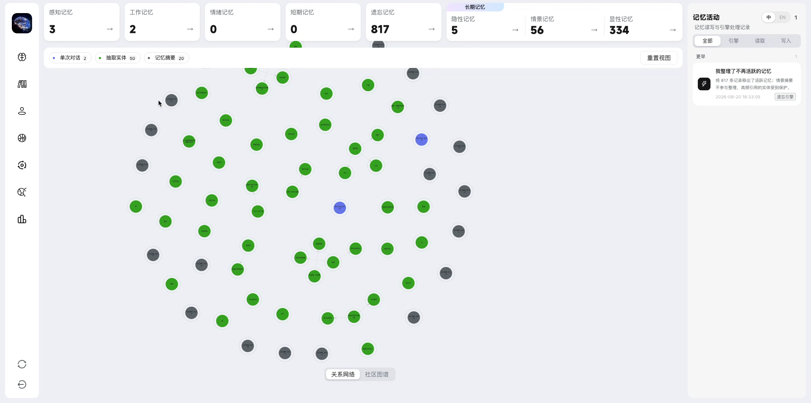
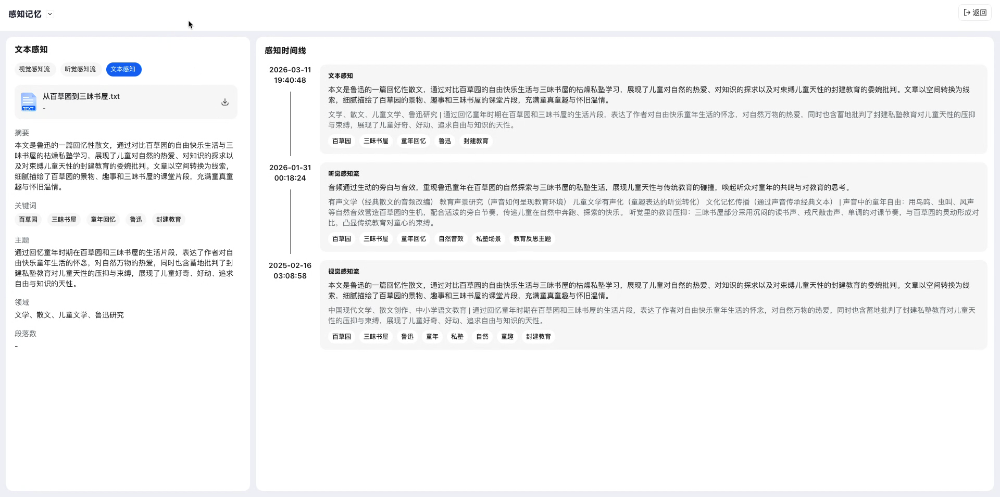
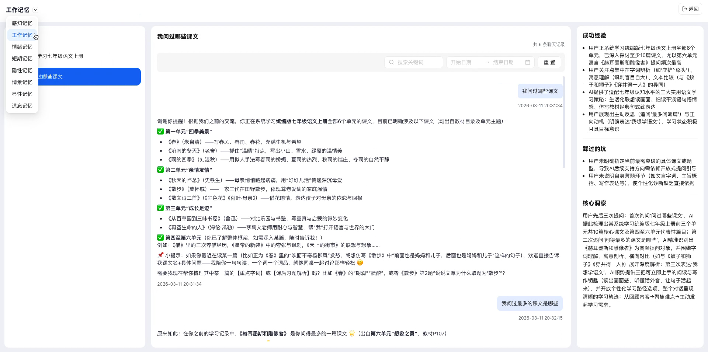
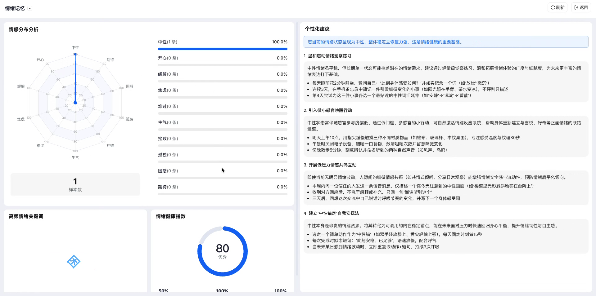
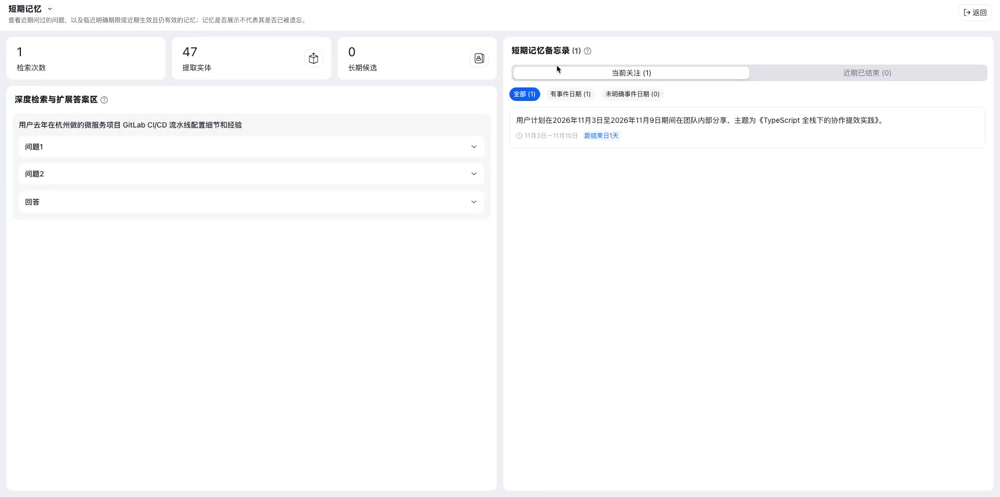
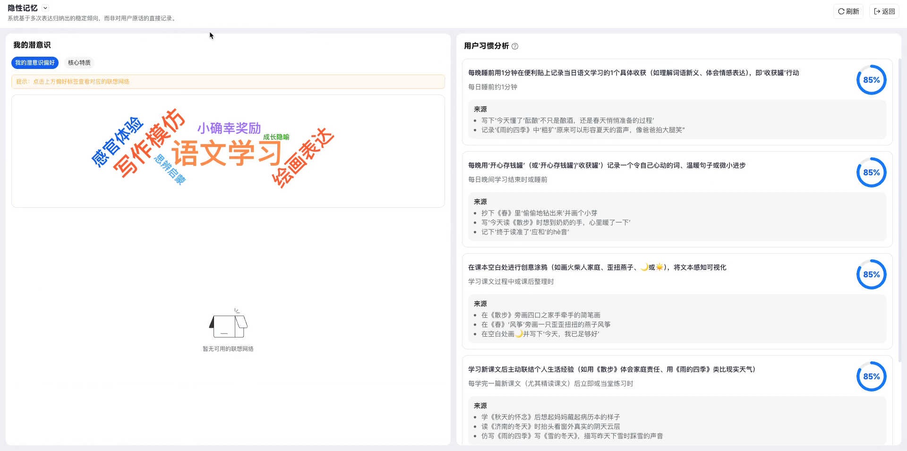
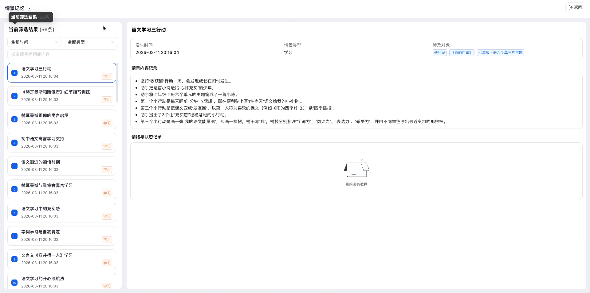
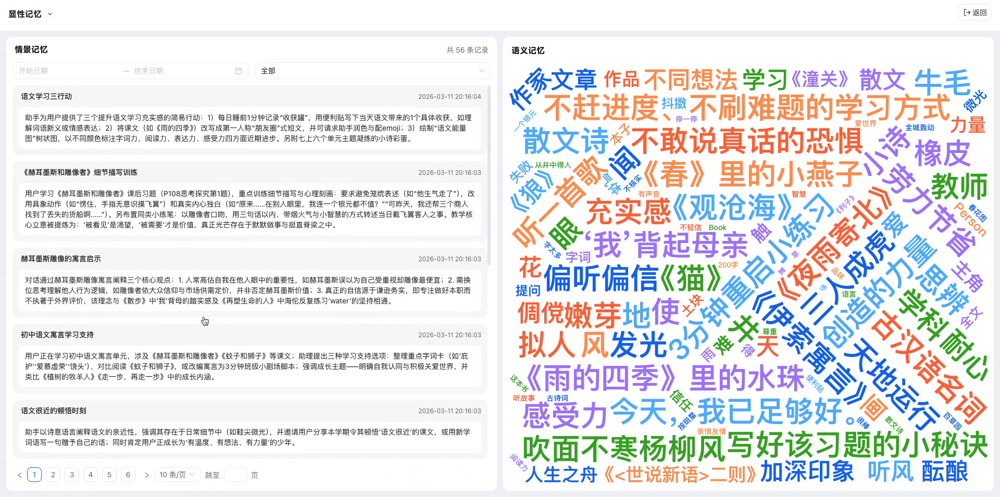
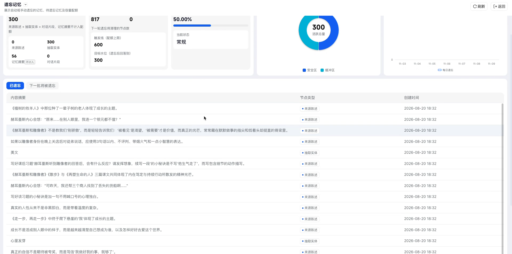

# 八大记忆分类

记忆熊会把交互中形成的记忆整理为八种类型，帮助你从信息输入、当前任务、情绪变化、近期关注、长期认知和记忆生命周期等角度了解自己。

本文将介绍八类记忆分别记录什么，以及如何查看每一类记忆。

> [!NOTE]
> 页面中的「长期记忆」是一个分组，包含**隐性记忆、情景记忆和显性记忆**。因此，记忆熊展示的八类记忆分别是：感知记忆、工作记忆、情绪记忆、短期记忆、遗忘记忆、隐性记忆、情景记忆和显性记忆。
>
> 本文截图取自多个示例用户，用于完整展示不同记忆类型及其页面状态。截图中的记忆数量、主题和分析结果彼此独立，不代表同一个用户的连续数据。

## 进入记忆空间

1. 打开记忆熊的空间层，进入**记忆库**。
2. 点击任意记忆卡片，进入对应的详情页。
3. 在页面顶部查看各类记忆的数量。
4. 进入详情页后，也可以点击左上角的分类名称，在下拉菜单中快速切换记忆类型。

 

*记忆空间会显示各类记忆数量、关系网络和最近的记忆活动。实际数据以你的使用情况为准。*

## 八类记忆一览

| 记忆类型 | 主要记录 | 适合查看 |
| --- | --- | --- |
| 感知记忆 | 从文字、音频和图片等内容中获取的信息 | 原始材料、摘要、关键词与感知时间线 |
| 工作记忆 | 当前任务或连续对话中正在处理的信息 | 对话脉络、成功经验、遇到的问题与核心洞察 |
| 情绪记忆 | 交互中出现的情绪及其变化 | 情感分布、高频情绪、情绪状态与建议 |
| 短期记忆 | 最近关注、近期有效或临近到期的信息 | 最近问过的问题、检索结果和长期记忆候选 |
| 隐性记忆 | 从多次表达中归纳出的稳定倾向 | 兴趣偏好、习惯、核心特质与行为建议 |
| 情景记忆 | 与具体时间、场景和对象相关的经历 | 事件经过、涉及对象、情绪和状态 |
| 显性记忆 | 可以直接描述和检索的事实、事件与知识 | 情景记录与语义关键词 |
| 遗忘记忆 | 已遗忘或即将进入遗忘流程的内容 | 遗忘状态、容量、趋势和节点明细 |

## 感知记忆

感知记忆保存记忆熊从输入材料中感知到的信息。页面按照内容来源分为**视觉感知流、听觉感知流和文本感知**。

在感知记忆详情页中，你可以：

- 预览或下载原始图片、音频和文本文件；
- 查看内容摘要、关键词、主题、领域和场景；
- 沿感知时间线查看同一内容在不同时间、不同媒介中形成的记录；
- 在视觉、听觉和文本标签之间切换。

*示例：文本感知页面会展示源文件、摘要、关键词等信息，并在右侧按时间排列相关感知记录。*

> [!TIP]
> 当同一份内容同时包含图片、音频和文字时，可以切换不同感知流，分别查看记忆熊从各类媒介中提取到的信息。

## 工作记忆

工作记忆聚焦当前正在进行的任务和连续对话。它会保留解决问题所需的上下文，并把对话中的有效方法和关键发现整理出来。

页面通常包含：

- **主题列表**：按任务或对话主题组织工作记忆；
- **对话记录**：展示问题、回复和形成时间；
- **成功经验**：归纳已经验证有效的做法；
- **踩过的坑**：记录曾经遇到的障碍或容易出错的环节；
- **核心洞察**：总结对后续任务有帮助的关键结论。

*选择左侧主题后，可以在中间查看完整对话，并在右侧查看系统提炼的经验和洞察。*

## 情绪记忆

情绪记忆用于回顾交互中出现过的情绪，并观察不同情绪的占比、关键词和整体状态。系统会根据已有样本生成情绪健康指数和个性化建议。

页面主要包含：

- **情感分布分析**：用雷达图展示开心、期待、困惑、孤独、挫败、生气、难过、焦虑、缓解和中性等情绪，并列出各类情绪的记录数和占比；
- **样本数**：显示当前分析使用的情绪记录数量；
- **高频情绪关键词**：用词云呈现近期反复出现的情绪表达；
- **情绪健康指数**：综合当前样本给出状态分数；
- **个性化建议**：结合主要情绪、情绪波动和恢复情况，生成可执行的练习建议。

*示例截图来自一名具有完整情绪分析结果的用户。不同用户的情绪类型、样本数、指数和建议会有所不同。产生新记录后，可点击右上角的「刷新」更新分析。*

> [!NOTE]
> 当样本较少时，雷达图、关键词或指数可能暂时为空。个性化建议会随情绪记录增加而更新。情绪记忆仅用于回顾和自我观察，不替代专业的医疗诊断或心理咨询。

## 短期记忆

短期记忆集中展示最近问过的问题，以及临近有效期、近期生效且仍然有效的记忆。页面分为**深度检索与扩展答题区**和**短期记忆备忘录**两部分。

页面顶部会汇总：

- **检索次数**：近期触发记忆检索的次数；
- **提取实体**：从交互内容中识别出的实体数量；
- **长期候选**：具备进一步沉淀为长期记忆条件的内容数量。

在**深度检索与扩展答题区**中，每次检索会保留用户问题，并将相关问题和回答折叠展示。点击对应条目即可展开查看。

在**短期记忆备忘录**中，你可以：

- 在「当前关注」和「近期已结束」之间切换；
- 按「全部」「有事件日期」或「未明确事件日期」筛选；
- 查看备忘事项的内容、起止日期和状态；
- 打开与该事项相关的记忆或详情。

*示例截图来自一名存在当前关注事项的用户，因此右侧显示了一条带日期范围的备忘录。其他用户可能显示不同数量的备忘录，或显示空状态。*

> [!NOTE]
> 短期记忆会随有效期、关注状态和检索行为动态变化。某条记忆没有出现在短期记忆页面中，并不代表它已经被遗忘；它也可能已经结束、转入其他记忆类型，或被当前筛选条件隐藏。

## 隐性记忆

隐性记忆不是对某一句原话的直接保存，而是记忆熊根据多次表达归纳出的稳定倾向，例如兴趣偏好、行为习惯和核心特质。

页面分为两部分：

- **我的潜意识**：通过词云和关联网络呈现潜意识偏好与核心特质；
- **用户习惯分析**：展示归纳出的习惯、适用情境、信息来源和可信度。

*每条习惯分析会附带来源，便于理解系统为何形成该判断。*

> [!TIP]
> 隐性记忆需要多次、相对一致的表达才能逐步形成。刚开始使用时，页面内容较少属于正常情况。

## 情景记忆

情景记忆把具体经历整理为可回顾的事件。每条记录会尽量保留事件发生的时间、类型、涉及对象、内容和情绪状态。

你可以：

- 按时间范围和情景类型筛选记录；
- 搜索情景标题或内容；
- 从左侧列表选择一条情景；
- 在右侧查看发生时间、情景类型、涉及对象、内容记录及情绪状态。

*情景记忆适合回顾“什么时候、发生了什么、涉及谁或什么”的具体经历。*

## 显性记忆

显性记忆呈现可以被直接描述、理解和检索的信息。页面将相关的**情景记忆**与**语义记忆**并列展示：左侧用于查看具体记录，右侧通过词云呈现高频知识、概念和主题。

你可以使用日期和类型筛选器缩小记录范围，也可以通过分页查看更多内容。 

*语义词云中字号较大的词，表示它们在当前记忆数据中更突出。*

## 遗忘记忆

遗忘记忆用于管理记忆的生命周期。这里会集中展示已经遗忘的内容、下一批可能进入遗忘流程的内容，以及当前容量和遗忘趋势。

页面提供：

- 当前记忆来源与节点数量；
- 下一轮遗忘清理的节点数和触发线；
- 当前容量状态；
- 活跃容量分布和每日遗忘趋势；
- 「已遗忘」与「下一批将被遗忘」两个列表；
- 每条节点的内容摘要、节点类型和创建时间。

 

*切换顶部标签，可以分别查看已经遗忘的内容和下一批可能被遗忘的内容。*

## 常见问题

### 为什么某类记忆显示为 0？

该类型暂时没有足够的数据，或者系统尚未从现有内容中形成对应记忆。继续与记忆熊交互、导入材料或完成相关任务后，页面会逐步更新。

### 为什么短期记忆中找不到之前的问题？

短期记忆会随有效期和关注状态变化。先检查「当前关注」「近期已结束」及事件日期筛选条件。短期页面没有显示某条内容，不代表它一定已经被遗忘。

### 为什么隐性记忆与我的一句原话不完全一致？

隐性记忆来自多次表达的综合归纳，不是原话摘录。你可以查看每条分析附带的来源，了解该结论基于哪些记录形成。

### 图表或分析为什么暂时为空？

部分分析需要达到一定的数据量才会生成。如果页面提供「刷新」按钮，可以在产生新记忆后刷新查看；否则等待系统完成后续处理即可。

### 各类记忆的数量为什么会变化？

随着新内容写入、短期记忆转化、分析结果更新或记忆进入遗忘流程，各分类的数量会动态变化。